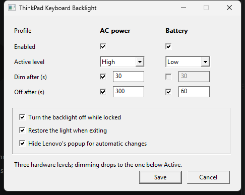

# thinkpad-kbd-light

Keyboard backlight control for ThinkPads on Windows.

ThinkPad firmware forgets the keyboard backlight level across sleep and reboot, and always
comes back dark. This fixes that, and adds idle dimming, idle timeout, and separate
profiles for AC and battery.

<p align="center"></p>

**Status: feature complete.** `tkbl-tray` runs in the notification area and does the whole
job — light on input, dim and off on idle, AC/battery profiles, re-applying the level after
sleep, and a settings window.

<p align="center"></p>

## How it works

`\\.\IBMPMDRV` — the Lenovo Power Management driver — is a *generic ACPI method
evaluator*: each IOCTL code names a 4-character ACPI method that the driver evaluates with
a single DWORD argument.

```
IOCTL 0x222680  ->  ACPI MLCG  ->  get backlight state
IOCTL 0x222684  ->  ACPI MLCS  ->  set backlight level
```

Both are `METHOD_BUFFERED` with a 4-byte input and 4-byte output. The device grants
`FILE_ANY_ACCESS`, so **no administrator rights are needed**.

This replaces the approach used by the older
[kingboyk/Thinkpad-Backlight](https://github.com/kingboyk/Thinkpad-Backlight), which
depended on `PWMTR64V.DLL` from the long-retired ThinkVantage Power Manager. That DLL is
gone from modern systems — but it was only a wrapper. The kernel driver underneath is
still shipped, still WHQL-signed, and still maintained, so we talk to it directly.

The interface was recovered by static analysis of `ibmpmdrv.sys`; the full derivation is in
`notes/` (untracked).

## Requirements

- A ThinkPad with the Lenovo PM driver (`ibmpmdrv.sys`) installed — it ships with the
  standard ThinkPad driver set.
- Windows 10/11, x64.
- Rust (MSVC toolchain) to build.

Developed and verified on a **ThinkPad X1 Carbon 6th Gen (20KG)**, BIOS 1.68, Windows 11
26100. Other ThinkPads that expose the `MLCG`/`MLCS` ACPI methods should work; some models
use `KLCG`/`KLCS` instead, which the two-tier HAL makes easy to add.

## Footprint

It runs all day, so this matters. Measured on the X1C6 over 60 s idle, with the 250 ms
state-machine tick and the once-a-second hardware poll both running:

| | |
|---|---|
| CPU | **0.31 %** of one core (0.039 % of the 8-core machine) |
| Working set | **10.5 MB** |
| Private bytes | **1.5 MB** |
| `tkbl-tray.exe` | 354 KB |

The C runtime is linked statically, so the binaries import nothing but Windows' own DLLs
(`kernel32`, `user32`, `gdi32`, `shell32`, `advapi32`, `wtsapi32`, `ntdll`). No Visual C++
Redistributable, no .NET, no installer. Each executable is independent — the tray does not
need the CLI present.

The once-a-second `MLCG` poll traps into SMM; measured at **1.75 ms median** per call, so
about 0.2 % of a core, and most of what is left.

## Build

```sh
cargo build --release
```

Needs `rc.exe` from the Windows SDK to embed the icon — the MSVC toolchain already requires
it. Without one the build still succeeds, just without an icon.

The icon is generated rather than checked in as art:

```sh
python assets/make_icon.py     # rewrites assets/tkbl.ico
```

## Usage

```sh
tkbl get              # -> off | low | high
tkbl set low          # off|low|high, or 0|1|2
tkbl info             # driver status + decoded MLCG bitfield
tkbl test             # cycle off -> low -> high, then restore
```

### The application

```sh
tkbl-tray             # the real thing: runs in the notification area, no console
```

The icon shows the current level. Left-click opens the settings window; right-click gives:

```
  On (high) / Dim (low) / Off      pick a level by hand
  Profile: AC                      which profile is active
  Pause automatic control
  Settings…                        the settings window
  Start with Windows
  Exit                             restores the active level on the way out
```

Picking a level by hand, like pressing `Fn+Space`, pauses automatic control until the next
wake — the program will not fight you for the backlight.

### Settings

Both profiles are shown side by side, because the asymmetry between them is the point.
Each timeout has its own tick box, so either can be switched off independently.

There is no "dim to" setting. With three levels, the only target that is not already
expressible through the two timers is the level below Active — anything else just turns
the dim timer into a second off timer — so dimming always drops one step.

Controls that cannot apply are greyed out rather than silently ignored: an active level of
`Low` leaves no room to dim first, so only the off timer applies; `Off` disables both.

Settings live in `%LOCALAPPDATA%\ThinkpadKbdLight\settings.json`. Hand edits are picked up
within a few seconds, no restart needed.

### The console daemon

```sh
tkbld                 # same behaviour, but logs what it is doing
```

Reads `%LOCALAPPDATA%\ThinkpadKbdLight\settings.json`, falling back to built-in defaults
when it does not exist. Logs each phase change so you can watch what it is doing:

```
tkbld running. settings: C:\Users\foo\AppData\Local\ThinkpadKbdLight\settings.json
power source: Ac
[phase] Active
[phase] Dim
[phase] Off
[phase] Active
```

```
$ tkbl info
device      : \\.\IBMPMDRV (opened, no elevation)
supported   : true
level       : high (2)
max level   : 2
raw MLCG    : 0x00050202
  bits 0-1  : 2 (current level)
  bit 9     : 1 (supported)
```

## Lenovo's on-screen popup

`tposd.exe` shows a popup every time the backlight level changes, which is useful when you
press `Fn+Space` and irritating when the program dims the keyboard on a timer.

There is no supported way to switch it off. The `MLCS` ACPI method raises a notification on
both of its branches — the `0x00010000` argument bit chooses between `MHKQ` and `MHKK`, not
whether to notify — and the values under `Software\Lenovo\OnScreenDisplay` are state, not
preferences.

So the popup is hidden instead, and only the one our own write caused: the visible windows
of `tposd` are noted immediately before writing, and a short-lived thread then hides
anything that appears over the next 700 ms. `Fn+Space` keeps its popup, because for that we
never write. Switch it off with "Hide Lenovo's popup for automatic changes" if you would
rather see them.

Measured on the X1C6, sampling as fast as the machine allows:

```
suppression off    OSD visible 3017 ms
suppression on     OSD visible    6 ms, 9 ms
```

Under one frame at 60 Hz. Note this is narrower than it sounds: `tposd` is not what draws
the volume popup (Windows does that), so only the ThinkPad hardware indicators are ever
touched, and only inside the 700 ms after one of our writes.

## The hardware has three states

`off`, `low`, `high`. There is no percentage — "dim" is literally the `low` state, so the
active → dim → off behaviour maps onto `high → low → off`.

The firmware animates between levels over roughly a second, so this program never
implements a fade of its own: it writes the target level and lets the EC ramp. `MLCG`
reports the *target* level immediately rather than the animated intermediate, so
reading back straight after a write is reliable.

## A note on safety

Every backlight change traps into SMM via the firmware, so the library deliberately:

- **never writes when the value is already correct** (write-on-change),
- **serialises all calls** behind a lock, so two SMI traps are never in flight,
- **rate-limits writes** in the HAL itself rather than trusting callers.

The `tkbl raw` subcommand can evaluate arbitrary ACPI methods and is gated behind
`--force`. Guessing IOCTL codes against a power-management driver can wedge the embedded
controller; don't.

## Library

```rust
use tkbl::{Backlight, BacklightController, Level};

let backlight = Backlight::open()?;
if backlight.is_supported() {
    backlight.set_level(Level::Low)?;
}
```

`FakeBacklight` implements the same trait for testing without hardware.

## Roadmap

- [x] **1** — HAL + CLI
- [x] **2** — idle state machine, settings model, AC/battery profiles
- [x] **3a** — daemon: idle detection, power/session/resume events
- [x] **3b** — tray icon and menu, autostart, single instance, restore-on-exit
- [x] **4** — settings window
- [x] **5** — first-run hint, OSD suppression, driver-failure surfacing

## Licence

MIT
